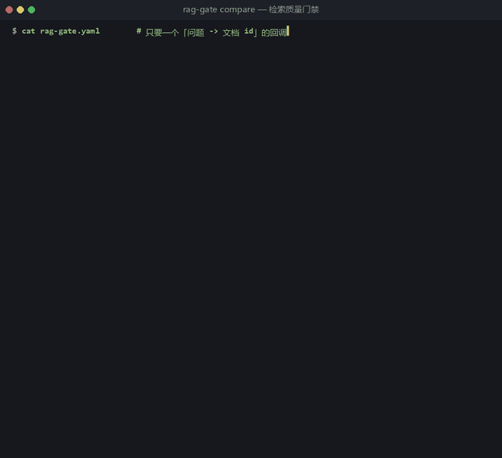

# rag-gate · 把 RAG 检索质量变成 CI 门禁

> **像跑单测一样跑 RAG 评测：改了切分、换了 Embedding、调了权重，退化了就不许合并。**

```bash
pip install rag-gate
rag-gate compare --config rag-gate.yaml     # 退化 → exit 1 → PR 变红
```



[English](README.md)

---

## 它不是编的：我们上周真的踩了这个坑

> 我们换了个 Embedding 模型。**维度一样、代码没报错、延迟还降了。**
> 三天后客户在群里投诉「回答完全不对」。
>
> 查下来：**写入侧换了模型，读取侧不知道** —— 向量空间对不上，检索结果全乱。
> 更糟的是三件事：
>
> - **没有任何门禁拦住它**（换模型不用过任何检查）
> - **没有任何监控看见它**（延迟、错误率全绿）
> - **是客户先发现的**
>
> 这个项目就是那次事故的产物。

## 为什么现有工具没覆盖

| 工具 | 做什么 | 缺什么 |
| --- | --- | --- |
| Ragas / DeepEval | 给一次结果**打分**，输出一个数字 | 不跟历史基线比，**不卡 CI** |
| promptfoo | 提示词层面的 A/B | 不针对**检索**质量 |
| 自己写脚本 | 一次性对比 | 不复用、不沉淀基线 |
| **rag-gate** | **和历史基线比，跌太多就 fail** | —— |

**空位就在这里**：打分已经有人做，**「和历史基线的门禁」没人做**。

## 30 秒跑通（零依赖，不用起数据库）

```bash
git clone https://github.com/your-org/rag-gate && cd rag-gate
pip install -e .            # 或者干脆不装，直接用 PYTHONPATH=src
cd examples

rag-gate baseline --config rag-gate.yaml    # 1) 把当前状态存成基线
rag-gate compare  --config rag-gate.yaml    # 2) 应该通过（exit 0）

# 3) 模拟「换了 Embedding 没同步」
#    macOS / Linux:  export RAG_GATE_DEMO=broken-model
#    Windows:        $env:RAG_GATE_DEMO = "broken-model"
rag-gate compare --config rag-gate.yaml     # -> exit 1，并打印谁跌了多少
```

`examples/adapters/dummy_retriever.py` 是个**假检索器**，不联任何库、结果确定，
就为了让上面三条命令 30 秒内看到「绿 → 红」的全过程。它内置四种事故模式：

| `RAG_GATE_DEMO` | 模拟的事故 | 会看到什么 |
| --- | --- | --- |
| `healthy`（默认） | 一切正常 | 全绿 |
| `broken-model` | 换 Embedding 没同步 | 指标跌 + **相似度分布下移** |
| `dup-write` | 写入重试没幂等 | mrr/ndcg 跌（重复副本挤掉答案） |
| `shrink` | 检索只返回 2 条 | recall 跌、但**分布稳定** |

最后两行的区别很重要：**同样是指标跌，原因完全不同**。

退化时终端长这样（颜色省略）：

```
指标          基线      本次      变化       允许跌幅    判定
────────────  ────────  ────────  ─────────  ──────────  ──────
recall@5      0.9688    0.4688    -0.5000    0.05        FAIL
hit_rate@5    1.0000    0.5625    -0.4375    0.05        FAIL
mrr           0.9583    0.1542    -0.8042    0.05        FAIL
ndcg@5        0.9396    0.2194    -0.7201    0.05        FAIL
相似度分布（drift）
  top1.mean  0.9700 → 0.4600   -0.5100
  结论：分布整体大幅下移：很像写入侧/读取侧的 Embedding 不一致
门禁结果：检索质量退化（exit 1）
```

> 管道的输出永远不带颜色（`NO_COLOR` 也认），所以 `--format json | jq` 是安全的：
> 报告走 stdout，提示和结论走 stderr。

## 怎么接到我自己的项目

只要给它一个「问题 → 文档 id 列表」的函数，**不 import 任何向量库、不做集成**。

```yaml
# rag-gate.yaml
dataset: golden.jsonl          # 每行 {id, question, expected_doc_ids, [expected_answer]}

retriever:
  type: python                 # python | http | command
  target: my_app.retrieve      # 或 ./scripts/retrieve.py:retrieve
  top_k: 10

metrics: [recall@5, hit_rate@5, mrr, ndcg@10]

gate:
  baseline: baseline.json
  max_drop:                    # ★ 主判据：相对基线允许的最大跌幅
    recall@5: 0.02
    mrr: 0.03
  min_absolute:                # 可选兜底，防基线本身就很差
    recall@5: 0.60
  drift:
    mean_drop: 0.02            # top1 相似度均值允许的下移幅度

report:
  formats: [table, markdown, json]
  output_dir: .rag-gate
```

你的函数长这样就行，返回什么形状都认：

```python
def retrieve(query: str, k: int) -> list:
    return ["doc_1", "doc_7"]                          # 只要 id
    # 或者带上分数，drift 就能用：
    # return [{"doc_id": "doc_1", "score": 0.91}, ...]
```

HTTP 检索服务和命令行检索器也支持，写法都写在
[`examples/adapters.example.yaml`](examples/adapters.example.yaml) 里。

## ★ 为什么比的是「相对退化」，不是「绝对分数」

绝对阈值极难定：不同数据集、不同业务要求差异巨大，**定错了这个工具就没人用**。

所以主判据是 **`max_drop`（相对基线允许的最大跌幅）**，`min_absolute` 只是可选兜底。
这条设计决策决定了它能不能被别人的项目接进去。

## 四个命令 + 三种退码

| 命令 | 作用 |
| --- | --- |
| `rag-gate run` | 跑一次，出报告（不判定） |
| `rag-gate baseline` | 把当前结果存成基线（**人工确认后提交进仓库**） |
| `rag-gate compare` | 和基线比并执行门禁（CI 用） |
| `rag-gate drift` | 只看相似度分布漂移 |

| 退码 | 含义 | 看到它该做什么 |
| --- | --- | --- |
| `0` | 通过 | 合并 |
| `1` | 检索质量退化 | 看 diff 表，确认是有意改动就去刷新基线 |
| `2` | 配置或取数错误 | 这是**没跑起来**，不是检索坏了 |

**三种退码必须分开** —— 否则用户分不清「是我检索坏了」还是「我配置写错了」。

## 指标定义（避免歧义）

| 指标 | 定义 |
| --- | --- |
| `recall@k` | 期望文档中，出现在前 k 的比例（**多文档**场景主指标） |
| `hit_rate@k` | 前 k 里**至少命中一个**的比例（**单文档**场景更直观） |
| `mrr` | 第一个命中位置的倒数均值 |
| `ndcg@k` | 带位置折扣的排序质量（二值相关性） |
| `similarity_drift` | top1 相似度的**分布变化**（均值/中位数/分位数），专抓「向量空间变了」 |

**为什么要有 `drift`**：前四个指标是「结果对不对」，drift 是「过程变没变」。
Embedding 那次事故里，**结果指标可能还没崩到阈值以下，相似度分布已经整体下移了** ——
那是最早的信号。

> 约定：多返回不相关文档不会扣分，也不会加分；重复 id 只算一次；
> `mrr` 只看前 k 名里的第一个命中。

## CI 集成（贴 PR 评论那种）

[`.github/workflows/gate.yml`](.github/workflows/gate.yml) 就是可以直接抄的模板：

```yaml
- run: pip install rag-gate
- run: rag-gate compare --config rag-gate.yaml --format markdown > comment.md
# 退化时 exit 1 -> PR 直接红；报告贴成 PR 评论（模板里有现成的 actions/github-script）
```

记得把 `baseline.json` 一起提交进仓库 —— 它是历史对比的唯一依据。
如果 golden set 自己变了，报告里会**警告**「新旧分数不可直接比较」（想更严格可以开
`gate.fail_on_dataset_change`）。

## Roadmap

- [x] v0.1.0 指标 + 三种 adapter + 基线对比 + 三种退码 + drift + markdown 报告
- [ ] 从 Ragas 结果里取答案分（可选，不绑依赖）
- [ ] `rag-gate diff --baseline a.json --current b.json`（不给检索器，纯比两份报告）
- [ ] GitHub Action 官方封装（`uses: rag-gate/action@v1`）
- [ ] 按 query 维度的退化排名（最先坏的是哪几条问题）
- [ ] 与在线监控的衔接（把线上抽样结果喂回门禁）

## 贡献 / 开发

```bash
pip install -e ".[dev]"
pytest -q                     # 测试不需要任何外部服务（HTTP adapter 自己起本地服务器）
python examples/_demo_walkthrough.py   # 端到端看四种事故 + 三种退码
```

Issue / PR 都欢迎。特别想要的反馈：**你接自己的检索器时，哪一步最卡**。

## License

MIT
